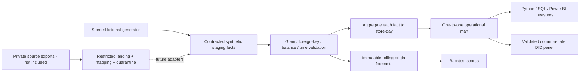

# Architecture and model boundaries

Only the synthetic branch is implemented. No credentials, live source connectors, OCR-derived
facts, private data ingestion or official score calculation are shipped. `etl.py` is a fail-fast
contract/reconciliation layer and mart builder; source-specific adapters await exports.

Separate conformed Store, Date, Item, Channel, Daypart and Platform dimensions. In Power BI use
one-to-many, single-direction dimension-to-fact relationships. Do not join sales directly to
shifts, inventory items, platforms or dayparts from other facts. Aggregate each independently
before a store-day join. Compare report snapshots only with matching period, population,
extract timestamp and metric definition. Do not sum week totals alongside daily rows.

Synthetic dates are calendar dates, Monday–Sunday weeks; they do not reconstruct the official
financial calendar. `date` is a fictional trading date, not a timestamp derived using a presumed
midnight cutoff. Forecast origin and target are distinct Date roles. A real feed needs timezone,
trade-date rule, extraction timestamp, source row ID, batch ID, schema version, file hash,
quarantine reason and idempotent merge key. Never use employee names as a key.

## Inventory accounting

PO order/line is a commitment. A receipt references that line and changes stock on receipt date.
Multiple receipts per PO line are allowed; a short receipt is not silently filled to ordered qty.
Cases convert to base units using explicit pack size. In real feeds version pack size and costs
at transaction time. `apply_date` remains unmapped until confirmed.

Actual usage = opening + received + transfer-in - transfer-out - closing.
Unexplained usage = actual usage - theoretical usage - recorded waste.
Expected closing = opening + receipts + transfers net - theoretical usage - waste.
Count variance (actual minus expected) = -unexplained usage. A positive unexplained value means
loss beyond recorded usage. Never subtract waste twice from usage cost.

The demo uses daily consolidated physical counts, fixed base-unit standard costs, fictional
per-transaction recipe coefficients and same-date paired transfers. Real counts may be weekly
and location-specific: calculate usage between count boundaries, aggregate locations first,
and do not fabricate daily physical counts. Purchase prices, invoice costs, standard usage
valuation and waste valuation are different measures. No FIFO/weighted-average valuation,
yield conversion, production batch or sales-item recipe accuracy is claimed.

## Operational metrics

Service counters represent a fictional all-orders timer, not the official pack or OTD timer.
Delivery handoff has its own totals/counts. A no-data drive-thru view stays unavailable.
Availability is a time/check proxy, separate from inventory balances. Delivery issue rate is a
fictional adverse rate, not an assertion that the source's 'accuracy' field has this meaning.
Platform ratings require weighted response counts and remain unavailable. Official Gold Standard,
peak speed, loyalty, WACL, scheduled peak measures, gap/wash, SSSG and scorecard outputs are not
recreated from insufficient evidence. Store source reported values as snapshots with units,
period/window, coverage, rule version and provenance before attempting reconciliation.
